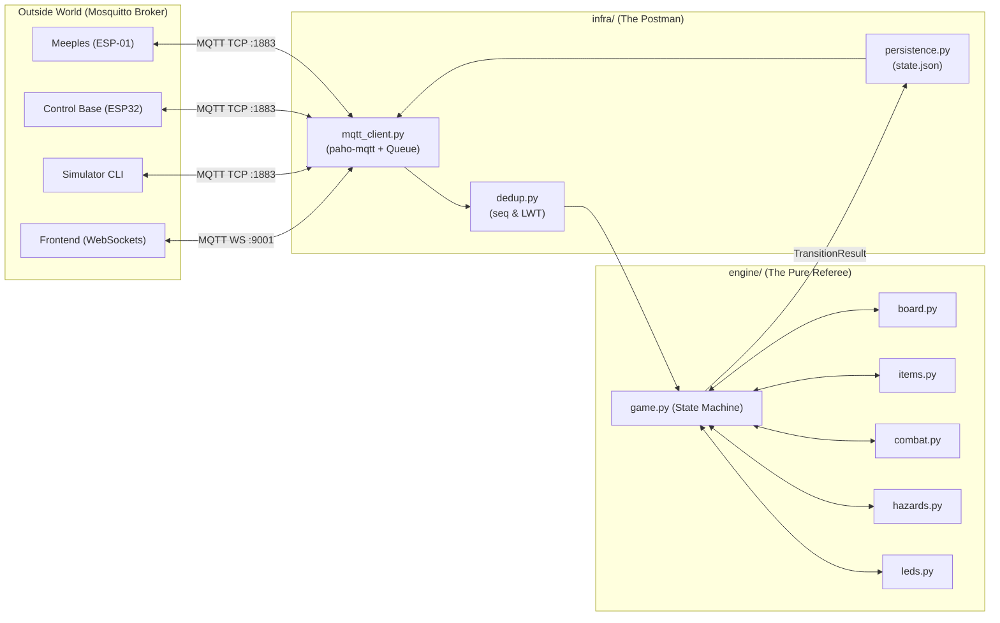

# Last Meeple Standing — Game Controller Detailed Plan

> **Purpose:** A beginner-friendly, zero-context-assumed architecture and work-split plan for building the `game-controller` (and preparing for the `frontend`) with two developers working in parallel.
>
> See also: [game_controller_wiring.md](game_controller_wiring.md) for exact module interfaces, threading, and runtime wiring.

---

## 1. The Big Picture (No Context Assumed)

**Last Meeple Standing** is a 4-player, turn-based battle royale board game played on a physical **4×4 grid** (`A1`–`D4`):

- **4 Meeples (ESP-01 + RFID reader + 1 red LED):** Each player's physical piece. It detects which cell it is standing on by reading an RFID sticker under the board, and it can blink its single red LED.
- **1 Shared Control Base (ESP32 + LCD + 1 button + buzzer):** Shared by all players. It displays the game state and a menu for whoever's turn it is (short press = next option, long press = select).
- **1 Frontend (Web App):** A read-only screen (laptop/monitor) that renders the board, HP, items, hazards, and debug logs.
- **1 Game Controller (Python on PC — *what we are building*):** The **single source of truth / referee**.

> [!IMPORTANT]
> **Golden Rule of the Architecture:** Hardware devices are "dumb" I/O. Meeples never decide if a move is legal, and the control base never calculates damage. Devices only send **inputs** (*"meeple m2 touched RFID tag `04A1B2C3`"*, *"player selected Attack on m1"*) and render **outputs** (*"blink error LED"*, *"show this updated game snapshot"*, *"play hit sound"*). All communication goes through a **Mosquitto MQTT broker** running in Docker on the PC.

### How the Game Controller Is Layered

To let two developers work at the same time **and** test game rules without needing physical hardware or even Docker running, we split the Python project into **4 strict layers**:



- **`protocol/` (Shared Language):** Data structures (Pydantic models & Enums) representing every MQTT message and the `GameState`. Both `infra/` and `engine/` import from here.
- **`engine/` (The Pure Referee):** Pure Python game rules. **Zero MQTT imports, zero file I/O, zero network calls.** You pass it an input and a state; it returns the updated state plus a list of events and LED changes.
- **`infra/` (The Postman):** Talks to Mosquitto (`paho-mqtt`), queues messages safely onto one thread, drops duplicate messages, saves `state.json` to disk, and publishes the engine's outputs back to MQTT.
- **`simulator/` (Testing Tool):** A CLI that pretends to be the 4 meeples and the control base over MQTT, using the exact same `protocol/` models.

---

## 2. Deep Dive: What Goes Inside `engine/`?

Think of `engine/` as a **board game rulebook translated into Python**. If you took away MQTT, ESPs, and Wi-Fi completely, you could still play an entire game of Last Meeple Standing inside a Python terminal or `pytest` by calling `engine/` directly.

Every time something happens, the engine returns a **`TransitionResult`**:
```python
@dataclass
class TransitionResult:
    state_changed: bool               # Should we increment `rev`, save state.json, and publish game/state?
    events: list[GameEvent]           # Transient notifications (e.g. attack_hit, move_invalid) -> game/event
    led_updates: dict[str, LedPattern] # Only meeples whose LED pattern changed -> meeple/{id}/led
```

Here is what each module inside `engine/` owns:

### 2.1 `engine/board.py` — Geometry & RFID Translation
Knows everything about the physical 4×4 grid and nothing about players or turns.
- **Grid coordinates:** Rows `A`–`D` (0–3), columns `1`–`4` (0–3) → 16 cells (`A1` through `D4`).
- **Starting corners:** `{"A1", "A4", "D1", "D4"}`.
- **Adjacency checks:**
  - `is_orthogonal_adjacent(a, b)` → `True` only if Manhattan distance is `1` (up, down, left, right).
  - `is_diagonal(a, b)` → `True` if `|Δrow| == 1` and `|Δcol| == 1` (needed so we can return the exact error reason `"diagonal"` vs `"not_adjacent"`).
  - `orthogonal_neighbors(cell)` → list of valid adjacent cells.
- **RFID lookup:** Loads `config/board.json` (`{"04A1B2C3": "A1", ...}`) and translates raw tag UIDs into cell names (or `None` if unknown → triggers `unknown_tag`).

### 2.2 `engine/items.py` — Config-Driven Item Catalog, Pickups & Respawns
Owns the item catalog, loot drops, pickups, and respawn timers. Rather than hardcoding item subclasses or a Factory, items are **data-driven and immutable**:

- **Config file (`config/items.json`):** Stores all items and their balance stats (validated at startup by Pydantic). Adding a new weapon/heal or tuning M8 balance only requires editing JSON, not Python code:
  ```json
  {
    "default_weapon": "fists",
    "items": [
      { "id": "fists",      "type": "weapon",  "damage": 1, "hit_chance": 90, "rarity": "default",   "spawn_weight": 0  },
      { "id": "small_heal", "type": "healing", "heal_amount": 2,              "rarity": "common",    "spawn_weight": 30 },
      { "id": "knife",      "type": "weapon",  "damage": 2, "hit_chance": 85, "rarity": "common",    "spawn_weight": 25 },
      { "id": "large_heal", "type": "healing", "heal_amount": 4,              "rarity": "uncommon",  "spawn_weight": 15 },
      { "id": "sword",      "type": "weapon",  "damage": 3, "hit_chance": 75, "rarity": "uncommon",  "spawn_weight": 15 },
      { "id": "axe",        "type": "weapon",  "damage": 4, "hit_chance": 65, "rarity": "rare",      "spawn_weight": 10 },
      { "id": "spear",      "type": "weapon",  "damage": 5, "hit_chance": 55, "rarity": "legendary", "spawn_weight": 5  }
    ]
  }
  ```
- **Discriminated Union + `ItemCatalog`:** Two frozen Pydantic models (`WeaponSpec` and `HealSpec`, discriminated by `"type"`) are loaded into an `ItemCatalog` registry injected into `GameEngine`:
  - `catalog.get(item_id) -> ItemSpec`
  - `catalog.get_weapon(weapon_id) -> WeaponSpec`
  - `catalog.roll_random_item(rng) -> ItemSpec` (weighted draw using `spawn_weight`)
- **Initial board fill:** Spawns a random weighted item on each of the 12 non-corner cells using a seeded `random.Random` instance (for reproducibility).
- **Pickup logic (`apply_pickup`):** Called when a player legally enters a cell containing an item.
  - `WeaponSpec` → replaces the player's current weapon immediately (usable in the same turn).
  - `HealSpec` → adds `heal_amount` HP, capped at `10`.
  - Removes the item from `state.items` and starts a 3-round respawn timer in `state.respawn[cell] = 3`.
  - Returns a `pickup` event.
- **Respawn tick (`tick_respawns`):** Called at the end of each round. Decrements timers; when a timer reaches `0`, spawns a new random item **only if** the cell is not occupied by a living player and not on fire (and respects the chest cap — see §5 TODOs).

### 2.3 `engine/combat.py` — Attacks, RNG Rolls & Elimination
Owns fighting between adjacent players.
- **Target finder (`get_valid_targets`):** Returns all living players standing on cells orthogonally adjacent to the active player. (Used to populate `turn.targets` so the ESP32 base only shows valid rivals in its Attack menu.)
- **Attack resolution (`resolve_attack`):**
  1. Validates `target` is in `get_valid_targets`.
  2. Looks up the attacker's weapon (`damage`, `hit_chance`).
  3. Rolls `roll = rng.randint(1, 100)`.
  4. If `roll <= hit_chance`: subtracts `damage` from target's HP (clamped at `0`), emits `attack_hit`. If target HP reaches `0`, sets `alive = False` and emits `eliminated (cause="combat")`.
  5. Otherwise: deals 0 damage and emits `attack_miss (roll=roll)`.

### 2.4 `engine/hazards.py` — Lightning & Fire (Closing Zone)
Owns the anti-stalling environmental hazards (Milestone M8, cleanly isolated from core turns).
- **Lightning schedule:**
  - Rounds 1–2: 0 strikes
  - Rounds 3–6: 1 strike every 3 rounds (rounds 3, 6)
  - Rounds 7–10: 1 strike every 2 rounds (rounds 8, 10 — or 7, 9; see §5 TODOs)
  - Rounds 11–14: 1 strike per round
  - Rounds 15+: 2 strikes per round
- **Start of round (`schedule_lightning_warnings`):** Picks `N` random cells not currently on fire, stores them in `state.lightning`, and emits `lightning_warning`.
- **End of round (`resolve_lightning_strikes`):**
  - Deals 3 damage to any living player standing on a warned cell (eliminates if HP hits 0).
  - Destroys any item on that cell (starts its respawn timer).
  - Ignites fire on that cell for 2 rounds (`state.fire[cell] = 2`), clears `state.lightning`, and emits `lightning_strike`.
- **Fire tick & burn:**
  - At the **end of a player's turn** (`apply_fire_damage`): if the player is standing on a cell in `state.fire`, they lose 1 HP (emits `fire_damage`, and `eliminated` if HP reaches 0).
  - At the **end of a round** (`tick_fire`): decrements remaining rounds in `state.fire` and removes expired fires.

### 2.5 `engine/leds.py` — Pure LED Pattern Calculator
A single pure function `compute_leds(state: GameState) -> dict[str, LedPattern]`.
Because each meeple only has **one red LED**, this module translates game state into one of the 7 patterns defined in [protocol.md](../protocol.md#L164-L172):
- `dead` (off) — player eliminated
- `winner` (fast blink 5s then steady) — game finished and this player won
- `error` (fast blink 100ms) — `placed == False` (meeple was lifted or put on an illegal cell)
- `danger` (double flash) — player is standing on a burning or lightning-warned cell
- `active` (slow blink 500ms) — it is this player's turn
- `idle` (steady on) — alive, waiting for turn
- `off` — lobby, not placed on a corner yet

The controller compares the new LED map against the previous one and only publishes `lms/meeple/{id}/led` for meeples whose pattern actually changed.

### 2.6 `engine/game.py` — The Master State Machine (Orchestrator)
This is the entry point of `engine/`. It exposes **4 clean methods** (one per input type):
1. `handle_tag(meeple_id: str, msg: TagMessage) -> TransitionResult`
2. `handle_base_action(msg: BaseActionMessage) -> TransitionResult`
3. `handle_device_status(device_id: str, msg: StatusMessage) -> TransitionResult`
4. `handle_admin_cmd(msg: AdminCmdMessage) -> TransitionResult`

It manages the lifecycle of a match:
- **Phases:** `lobby` → `playing` ⇄ `paused` → `finished`.
- **Lobby:** Tracks which online meeples are physically placed on distinct corner cells (`A1`, `A4`, `D1`, `D4`). Allows `start` once ≥ 2 meeples are ready; randomizes turn order, spawns items, and begins Round 1.
- **Turn Flow (`turn.step`):**
  ```mermaid
  stateDiagram-v2
      [*] --> start: Turn begins
      start --> moving: Base sends "move"
      moving --> start: Base sends "cancel_move"
      moving --> moved: Active meeple placed on valid free adjacent cell
      start --> NextTurn: Base sends "attack" or "pass"
      moved --> NextTurn: Base sends "attack" or "pass"
      NextTurn --> [*]: Apply fire burn, check win, advance turn/round
  ```
- **Computing `turn.options`:** After every state change, `game.py` recalculates the exact list of legal buttons the ESP32 base is allowed to show:
  - In `start`: `["move"]` + (`["attack"]` if `targets` non-empty) + `["pass"]`.
  - In `moving`: `["cancel_move"]`.
  - In `moved`: (`["attack"]` if `targets` non-empty) + `["pass"]`.
- **Physical vs. Logical position (`placed` flag):**
  - If a meeple is lifted (`uid: null`) or placed on an illegal cell (diagonal, occupied, not their turn, or `Move` wasn't selected first), its **logical cell does not change**, `placed` becomes `False`, `move_invalid` is emitted, and its LED switches to `error`.
  - While the active player has `placed == False`, their turn is blocked until they place the meeple back onto its expected logical cell (which restores `placed = True`).
- **Auto-pause / resume:** If the active meeple or the control base goes offline (`online: false`), phase switches to `paused` (`reason: "device_offline"`). When all required devices are back online, it automatically resumes.
- **Win check:** After every elimination (or after round 20 finishes), checks if ≤ 1 player is alive (or picks highest HP at round 20), sets `phase = "finished"`, sets `winner`, and emits `game_over`.

### 2.7 Trace Example: One Turn End-to-End
Suppose it is `m2`'s turn (on `B2`), `m1` is on `B4`, and a `knife` is on `B3`:
1. Player selects **Move** on the ESP32 base → MQTT `lms/base/action {"action":"move","seen_rev":10,"seq":4}`.
2. `infra/mqtt_client.py` puts it in the `Queue` → `infra/dedup.py` checks `seq > last_seq` → calls `engine.handle_base_action(...)`.
3. `engine/game.py` checks `seen_rev` & `turn.options`, changes `turn.step = "moving"`, returns `TransitionResult(state_changed=True, events=[], led_updates={})`.
4. `infra/` increments `rev` to `11`, saves `state.json`, publishes retained `lms/game/state`.
5. Player moves meeple `m2` onto cell `B3` → MQTT `lms/meeple/m2/tag {"uid":"04...","seq":9}`.
6. `engine/game.py` asks `board.py` (`uid → "B3"`, orthogonal to `B2`? Yes, free? Yes) → updates `m2.cell = "B3"` → calls `items.apply_pickup` (equips `knife`, starts respawn timer) → asks `combat.get_valid_targets` (finds `m1` on `B4`) → sets `turn.step = "moved"`, `turn.options = ["attack", "pass"]`, `turn.targets = ["m1"]`.
7. `infra/` publishes `move_ok` + `pickup` on `lms/game/event` and updated `lms/game/state` (`rev: 12`).
8. Player selects **Attack → m1** → `engine/combat.py` rolls `1..100` against `knife` (85%) → hits for 2 dmg → `engine/game.py` applies fire burn check, advances turn to next player, asks `engine/leds.py` for new LED patterns (`m2: idle`, `next: active`), and `infra/` publishes everything.

---

## 3. What Goes Inside `protocol/`, `infra/`, and `simulator/`?

| Folder | Responsibility | Key Details |
|---|---|---|
| **`protocol/`** | Shared contract between all modules | `enums.py` (all string enums), `messages.py` (Pydantic v2 models for inputs & outputs — rejects malformed JSON safely), `state.py` (`GameState`, `PlayerState`, `TurnState`), `topics.py` (topic builders & regex parsers). |
| **`infra/`** | All I/O, threading & reliability | `mqtt_client.py` (`paho-mqtt` v2, QoS 2 publish & subscribe, `clean_session=False`, client id `lms-controller`, LWT on `lms/controller/status`, thread-safe `queue.Queue` bridge). `dedup.py` (tracks `last_seq` per device, resets on `status {online:true}`). `persistence.py` (writes `data/state.json` atomically via temp-file rename so crashes never corrupt it). |
| **`simulator/`** | Manual & scripted testing tool | `cli.py` (`uv run lms-sim`): interactive terminal tool using `typer` + `rich` to connect virtual meeples (`m1`–`m4`) and a virtual base to Mosquitto, send tag reads/lifts, pick menu actions, simulate Wi-Fi drops, and print live state/events/LEDs. `replay.py`: runs scripted JSON/YAML game scenarios with a fixed RNG seed for regression testing. |

---

## 4. Proposed Repository Layout

```text
last-mepple-standing/
├── docker-compose.yml                  # Mosquitto (1883 TCP + 9001 WebSockets)
├── mosquitto/
│   └── config/mosquitto.conf           # Listeners, persistence, allow_anonymous
└── game-controller/
    ├── pyproject.toml                  # uv project (pydantic, paho-mqtt, typer, rich; dev: pytest, ruff)
    ├── uv.lock                         # Committed so both devs have identical envs
    ├── config/
    │   ├── board.json                  # RFID UID -> Cell ("A1".."D4"), dummy UIDs until M4
    │   └── items.json                  # Config-driven weapons, heals, rarities & spawn weights
    ├── data/                           # gitignored runtime state.json
    ├── src/lms_controller/
    │   ├── main.py                     # `uv run lms-controller` entrypoint
    │   ├── protocol/                   # [Phase 0 — Shared Contract]
    │   │   ├── enums.py
    │   │   ├── messages.py
    │   │   ├── state.py
    │   │   └── topics.py
    │   ├── engine/                     # [Pure Game Rules — Zero MQTT]
    │   │   ├── board.py
    │   │   ├── items.py
    │   │   ├── combat.py
    │   │   ├── hazards.py
    │   │   ├── leds.py
    │   │   └── game.py
    │   ├── infra/                      # [MQTT, Dedup, Persistence]
    │   │   ├── mqtt_client.py
    │   │   ├── dedup.py
    │   │   └── persistence.py
    │   └── simulator/                  # [Manual & Replay Tool]
    │       ├── cli.py                  # `uv run lms-sim`
    │       └── replay.py
    └── tests/
        ├── conftest.py                 # Seeded RNG, sample board, state factories
        ├── unit/                       # Fast, no Docker needed
        └── integration/                # Real Mosquitto tests (`pytest -m integration`)
```

---

## 5. Open TODOs for Group Approval

> [!NOTE]
> None of these block development. We will implement the **proposed default** now and mark each with a `# TODO(group-approval):` comment so the group can confirm or tweak them at the next meeting.

1. **TODO — Item respawn cap ("limited to 2 chests on the board"):**
   - *Ambiguity:* [LastMeepleStanding.pdf](../LastMeepleStanding.pdf) says 12 items spawn at game start, and empty cells respawn after 3 rounds *"limited to 2 chests on the board"*.
   - *Proposed default:* Initial setup places 12 items; after that, a respawn timer only spawns a new item if `len(state.items) < 2` (or we make `max_respawn_items` a config constant so it's a 1-line tweak).
2. **TODO — Exact item string IDs:**
   - *Ambiguity:* PDF calls it `Legendary spear`, [protocol.md](../protocol.md#L194) uses `"spear"`.
   - *Proposed default:* Use short snake_case IDs everywhere: `fists`, `small_heal`, `knife`, `large_heal`, `sword`, `axe`, `spear`.
3. **TODO — End-of-turn vs. End-of-round order of operations:**
   - *Ambiguity:* Not explicitly ordered in the rules doc.
   - *Proposed default:*
     1. End of player's turn: apply fire burn damage (-1 HP if on burning cell) → check elimination → check last-player-alive win.
     2. If that was the last alive player in the round (end of round): resolve lightning strikes (-3 HP, destroy items, ignite 2-round fire) → check eliminations & win → decrement existing fire timers → decrement respawn timers & spawn items → if round == 20, resolve round-20 winner → increment `round` → schedule next round's lightning warnings.
4. **TODO — Round-20 HP tie-breaker:**
   - *Ambiguity:* Rules say *"the player with the most health wins"*, but don't specify ties.
   - *Proposed default:* If tied on HP after round 20, extend into sudden death (extra rounds with 2 lightning strikes/round) until one player has strictly more HP or is last alive.
5. **TODO — Lightning exact round numbers (rounds 7–10):**
   - *Ambiguity:* *"1 strike every 3 rounds"* (rounds 3–6 → rounds 3, 6) and *"1 strike every 2 rounds"* (rounds 7–10 → could be 8 & 10, or 7 & 9).
   - *Proposed default:* Strikes on rounds `{3, 6, 8, 10, 11, 12, 13, 14}` and 2 strikes/round from round `15+`.
6. **TODO — LED pattern priority when multiple states apply:**
   - *Ambiguity:* What if it is `m2`'s turn (`active`) AND `m2` is standing on a lightning-warning cell (`danger`)?
   - *Proposed default:* Priority order: `dead` > `winner` > `error` (misplaced) > `danger` > `active` > `idle` > `off`.

---

## 6. Two-Developer Work Split (Zero Stepping on Each Other)

### Phase 0 — Shared Foundation (Pair together, ~2–3h, merge to `master` first)
Both developers agree on the contract before splitting:
- [ ] Configure [docker-compose.yml](../../docker-compose.yml) + `mosquitto/config/mosquitto.conf` (TCP `1883` + WebSockets `9001`, `persistence true`, `allow_anonymous true`).
- [ ] Initialize `game-controller/` with `uv`, `pyproject.toml`, `ruff`, `pytest`, `.gitignore`, dummy `config/board.json`, and `config/items.json`.
- [ ] Implement `protocol/` (`enums.py`, `messages.py`, `state.py`, `topics.py`) + `engine/board.py` + `ItemSpec`/`ItemCatalog` schema + `TransitionResult`.

### Phase 1 — Parallel Core Development (Completely Separate Files)

| | **Developer A — Game Rules (`engine/`)** | **Developer B — Runtime, LEDs & Simulator (`infra/`, `simulator/`)** |
|---|---|---|
| **Files owned** | `engine/items.py`, `engine/combat.py`, `engine/game.py`, `tests/unit/test_items.py`, `test_combat.py`, `test_game.py` | `infra/mqtt_client.py`, `infra/dedup.py`, `infra/persistence.py`, `engine/leds.py`, `simulator/cli.py`, `tests/unit/test_infra.py`, `test_leds.py` |
| **Focus** | Lobby start, turn state machine (`start → moving → moved`), move validation & `placed` flag, item pickups, seeded combat rolls, elimination & win condition. | `paho-mqtt` QoS 2 client + LWT + `Queue` bridge, `seq` dedup, atomic `state.json` persistence, LED calculator, and interactive `uv run lms-sim` CLI. |
| **How they test independently** | Pure `pytest` unit tests — no broker needed. | Unit tests for dedup/persistence/LEDs + testing `mqtt_client` & `lms-sim` against local Docker Mosquitto. |

### Phase 2 — Wiring & First Playable Game (Short sync, ~1–2h)
- [ ] Wire `engine/game.py` + `infra/` together in `main.py` (`uv run lms-controller`).
- [ ] Run `docker compose up -d`, start `uv run lms-controller`, and play a complete game manually using `uv run lms-sim`.
- [ ] Add `tests/integration/` (marked `@pytest.mark.integration`) verifying QoS 2 delivery, retained state recovery after restart, and LWT pause/resume against the real broker.

### Phase 3 — Advanced Rules (M8) & Frontend (Parallel Again)
- **Developer A:** `engine/hazards.py` (lightning, fire, respawn timers, round-20 tie-breaker) + `simulator/replay.py` (scripted game scenarios).
- **Developer B:** `frontend/` read-only web app connecting to Mosquitto WebSockets (`ws://localhost:9001`), subscribing to `lms/#`, rendering the 4×4 board, player HUD, hazards, and live `lms/meeple/+/log` debug stream.

### Collaboration Rules
- **Branches:** Short-lived feature branches (`feat/combat-engine`, `feat/mqtt-client`) merged via PR into `master`.
- **Checks before every commit/PR:** `uv run ruff format --check . && uv run ruff check . && uv run pytest`.
- **Lockfile:** Always commit `uv.lock` so both machines run identical dependency versions.
