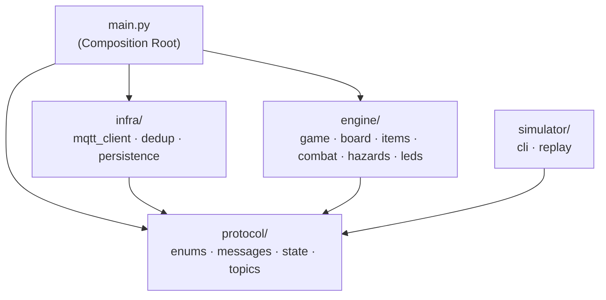
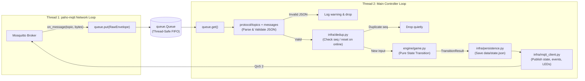
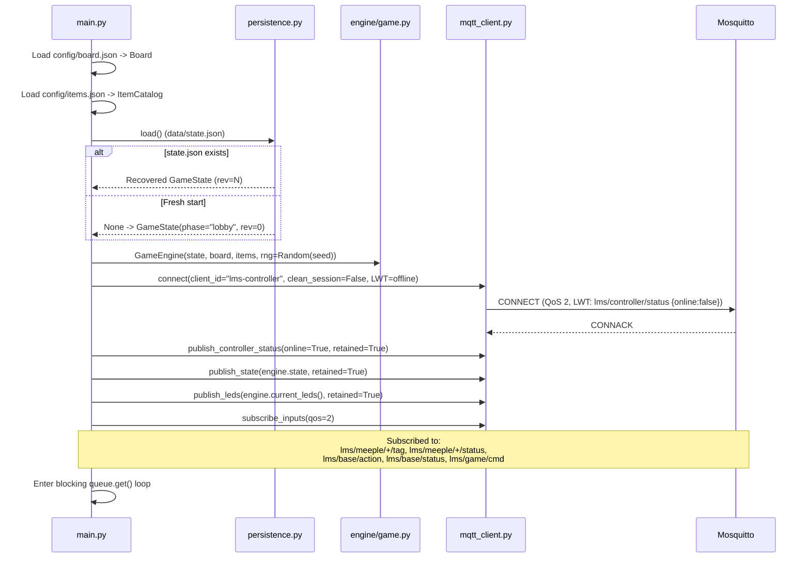
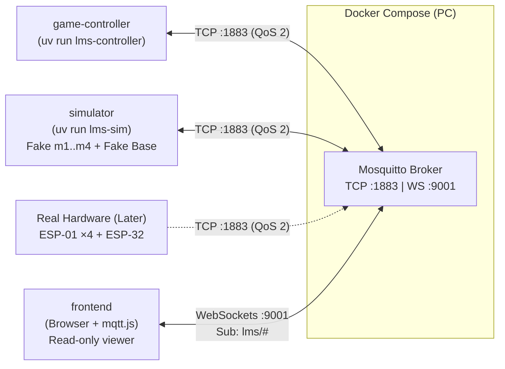

# Last Meeple Standing — Game Controller Wiring Guide

> **Purpose:** Shows *exactly* how every file in `game-controller` plugs together at startup and runtime, what interfaces Dev A (`engine/`) and Dev B (`infra/` + `simulator/`) must honor, and how threads and MQTT messages flow without race conditions.
>
> See also: [game_controller_plan.md](game_controller_plan.md) for the overall architecture, `engine/` breakdown, open TODOs, and 2-developer work split.

---

## 1. Module Dependency Rules (Who Can Import Whom)

To prevent circular imports and keep `engine/` 100% testable without MQTT, imports flow strictly **downward**:



**Hard rules:**
1. `protocol/` imports **nothing** from the rest of the project (only `pydantic` and stdlib).
2. `engine/` imports **only** `protocol/` and Python stdlib (`random`, `dataclasses`, `json`). **Never `paho-mqtt`.**
3. `infra/` imports **only** `protocol/` and external I/O libs (`paho-mqtt`). **Never `engine/`.**
4. `simulator/` imports **only** `protocol/` (plus `config/board.json`). It talks to `game-controller` **exclusively over Mosquitto**, just like the real ESP-01 and ESP-32 hardware.
5. `main.py` is the **only** file that knows about both `engine/` and `infra/` — it instantiates them and connects them together.

---

## 2. Threading Model & Message Queue Bridge

`paho-mqtt` runs network callbacks (`on_message`, `on_connect`) on a **background network thread**. Because [protocol.md](../protocol.md#L281-L283) requires strictly sequential turn processing, we never touch `GameState` on the network thread.



Why this matters:
- **Zero locks needed inside `engine/`:** Only Thread 2 ever reads or mutates `GameState`.
- **Crash-proof parsing:** Malformed JSON from a buggy ESP firmware is caught by Pydantic in Thread 2, logged, and dropped without crashing the controller.

---

## 3. Startup & Crash-Recovery Sequence

When `uv run lms-controller` starts (whether for a fresh game or after a PC crash), `main.py` executes this exact wiring sequence:



---

## 4. Exact Interface Contracts (Dev A ↔ Dev B)

Both developers code against these exact signatures so Phase 2 wiring takes minutes instead of hours.

### 4.1 Shared Output Contract (`protocol/results.py` or `engine/types.py`)
```python
@dataclass(frozen=True)
class TransitionResult:
    state_changed: bool
    events: list[GameEvent] = field(default_factory=list)
    led_updates: dict[str, LedPattern] = field(default_factory=dict)
```

### 4.2 Dev A's Engine Interface (`engine/game.py` & `engine/items.py`)
```python
class ItemCatalog:
    @classmethod
    def from_file(cls, path: Path) -> "ItemCatalog": ...
    @property
    def default_weapon(self) -> str: ...
    def get(self, item_id: str) -> ItemSpec: ...
    def get_weapon(self, weapon_id: str) -> WeaponSpec: ...
    def roll_random_item(self, rng: random.Random) -> ItemSpec: ...

class GameEngine:
    def __init__(
        self,
        state: GameState,
        board: Board,
        items: ItemCatalog,
        rng: random.Random,
    ) -> None: ...

    @property
    def state(self) -> GameState: ...

    def current_leds(self) -> dict[str, LedPattern]: ...

    # The 4 input handlers (called sequentially by main.py)
    def handle_tag(self, meeple_id: str, msg: TagMessage) -> TransitionResult: ...
    def handle_base_action(self, msg: BaseActionMessage) -> TransitionResult: ...
    def handle_device_status(self, device_id: str, msg: StatusMessage) -> TransitionResult: ...
    def handle_admin_cmd(self, msg: AdminCmdMessage) -> TransitionResult: ...
```

### 4.3 Dev B's Infra Interfaces (`infra/`)
```python
# infra/dedup.py
class Deduplicator:
    def is_duplicate(self, device_id: str, seq: int) -> bool: ...
    def reset_device(self, device_id: str) -> None: ...  # called on status {online: true}

# infra/persistence.py
class StateStore:
    def __init__(self, path: Path) -> None: ...
    def load(self) -> GameState | None: ...
    def save(self, state: GameState) -> None: ...  # atomic write via temp file + os.replace()

# infra/mqtt_client.py
@dataclass(frozen=True)
class RawEnvelope:
    topic: str
    payload: bytes

class MqttGateway:
    def __init__(self, host: str, port: int, inbox: queue.Queue[RawEnvelope]) -> None: ...
    def start(self) -> None: ...    # connects with LWT, clean_session=False, loop_start()
    def stop(self) -> None: ...     # publishes offline, disconnects cleanly
    def subscribe_inputs(self) -> None: ...
    def publish_controller_status(self, online: bool) -> None: ...
    def publish_state(self, state: GameState) -> None: ...          # QoS 2, retained=True
    def publish_event(self, event: GameEvent) -> None: ...          # QoS 2, retained=False
    def publish_led(self, meeple_id: str, rev: int, pattern: LedPattern) -> None: ...  # QoS 2, retained=True
```

---

## 5. The Wiring Glue (`main.py` / `runtime.py`)

Here is the complete dispatch loop that wires Dev A and Dev B together:

```python
class ControllerRuntime:
    def __init__(
        self,
        engine: GameEngine,
        mqtt: MqttGateway,
        dedup: Deduplicator,
        store: StateStore,
        inbox: queue.Queue[RawEnvelope],
    ) -> None:
        self.engine = engine
        self.mqtt = mqtt
        self.dedup = dedup
        self.store = store
        self.inbox = inbox

    def process_one(self, env: RawEnvelope) -> None:
        # 1. Identify topic and parse/validate JSON via protocol/
        route = parse_topic(env.topic)
        if route is None:
            return

        try:
            result = self._dispatch(route, env.payload)
        except ValidationError as exc:
            logger.warning("Malformed payload on %s: %s", env.topic, exc)
            return

        if result is None:
            return  # Dropped duplicate

        # 2. Apply side effects in strict order: persist -> publish events -> publish state -> publish LEDs
        if result.state_changed:
            self.store.save(self.engine.state)

        for event in result.events:
            self.mqtt.publish_event(event)

        if result.state_changed:
            self.mqtt.publish_state(self.engine.state)

        for meeple_id, pattern in result.led_updates.items():
            self.mqtt.publish_led(meeple_id, self.engine.state.rev, pattern)

    def _dispatch(self, route: TopicRoute, payload: bytes) -> TransitionResult | None:
        match route:
            case MeepleTagRoute(meeple_id=mid):
                msg = TagMessage.model_validate_json(payload)
                if self.dedup.is_duplicate(mid, msg.seq):
                    return None
                return self.engine.handle_tag(mid, msg)

            case BaseActionRoute():
                msg = BaseActionMessage.model_validate_json(payload)
                if self.dedup.is_duplicate("base", msg.seq):
                    return None
                return self.engine.handle_base_action(msg)

            case DeviceStatusRoute(device_id=did):
                msg = StatusMessage.model_validate_json(payload)
                if msg.online:
                    self.dedup.reset_device(did)
                return self.engine.handle_device_status(did, msg)

            case AdminCmdRoute():
                msg = AdminCmdMessage.model_validate_json(payload)
                return self.engine.handle_admin_cmd(msg)
```

> [!TIP]
> Notice how **`ControllerRuntime.process_one()`** can also be unit-tested in-memory by passing a fake `MqttGateway` and a temp `StateStore` — no Docker needed!

---

## 6. How `simulator/` and `frontend/` Wire Into the System

Neither the simulator nor the frontend ever imports `engine/` or `infra/`. They connect strictly over the Mosquitto broker:



**Why this helps the whole team:**
- **Game controller devs:** Run `lms-controller` + `lms-sim` to test full games before any ESP hardware is ready.
- **ESP-01 / ESP-32 devs:** Can run `lms-controller` + `lms-sim` for the *missing* devices (e.g., 1 real ESP-01 meeple + 3 simulated meeples + simulated base).
- **Frontend dev:** Can run `lms-controller` + `lms-sim --replay` to watch live games play out on the web UI over WebSockets (`:9001`).

---

## 7. Graceful Shutdown & Error Resilience

| Scenario | How the Wiring Handles It |
|---|---|
| **`Ctrl+C` / `SIGTERM` on controller** | Main loop exits → `mqtt.stop()` publishes `lms/controller/status {"online": false}` (retained) → closes socket cleanly. `state.json` is already up to date. |
| **Controller crashes abruptly (`SIGKILL`)** | Mosquitto fires LWT `lms/controller/status {"online": false}`. On restart, `persistence.py` reloads `data/state.json` and republishes retained `game/state` + `led`. |
| **Malformed JSON from a device** | Pydantic raises `ValidationError` inside `process_one()` → logged and skipped; queue keeps processing. |
| **Device reboots and restarts `seq` at `0`** | Device publishes `status {"online": true}` → `_dispatch` calls `dedup.reset_device(device_id)` so `seq = 1` is accepted. |
| **Two messages arrive simultaneously** | Both enter `queue.Queue` on Thread 1 and are processed strictly one-by-one on Thread 2. |
