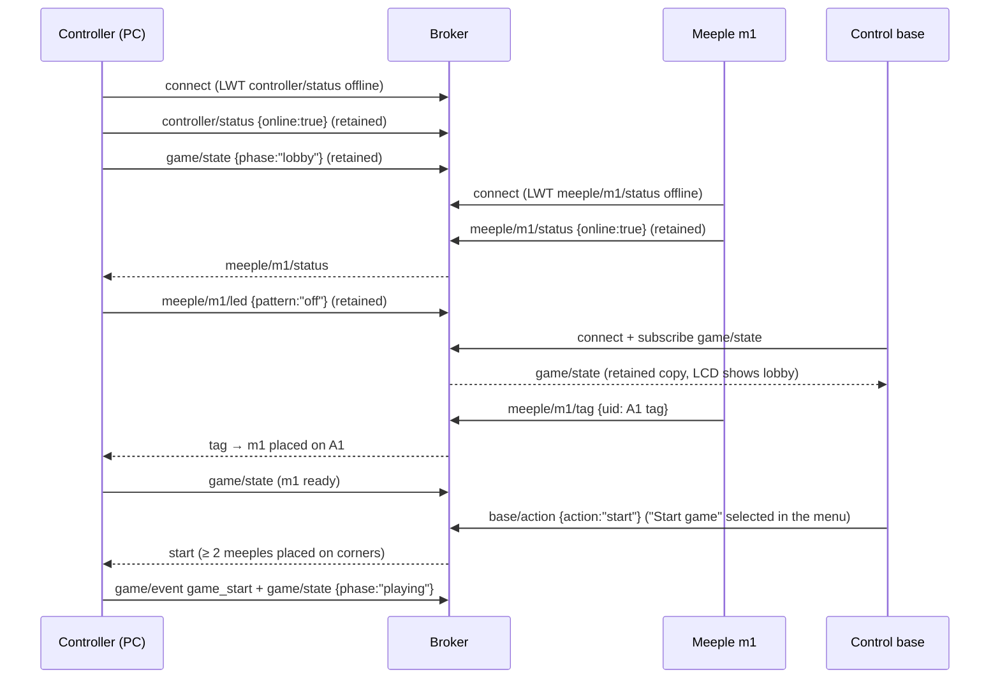
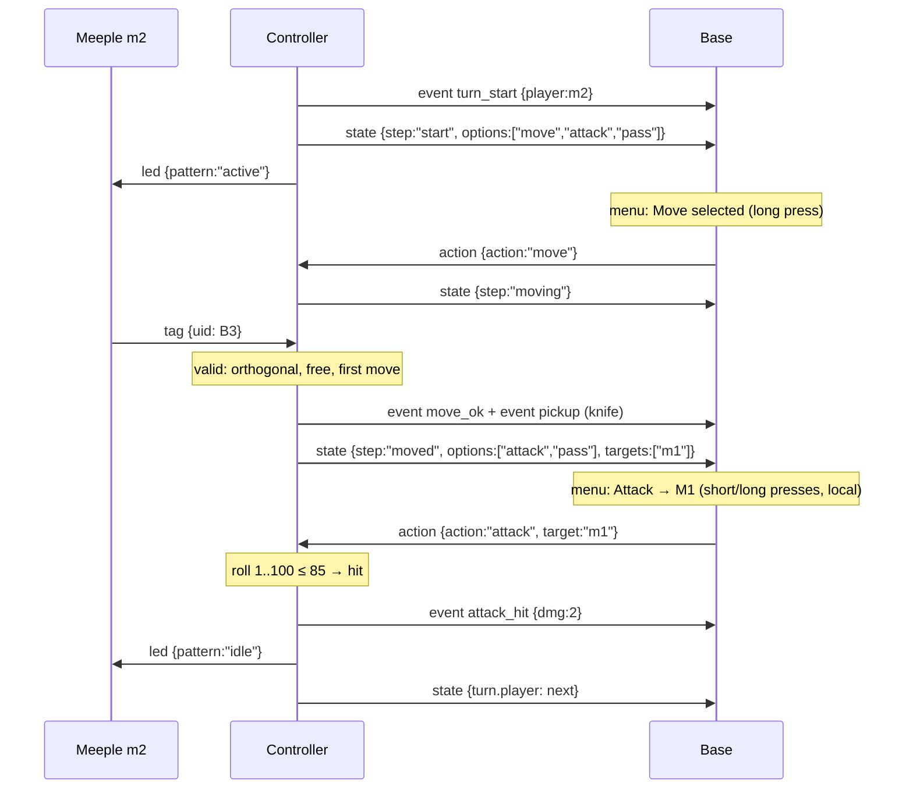
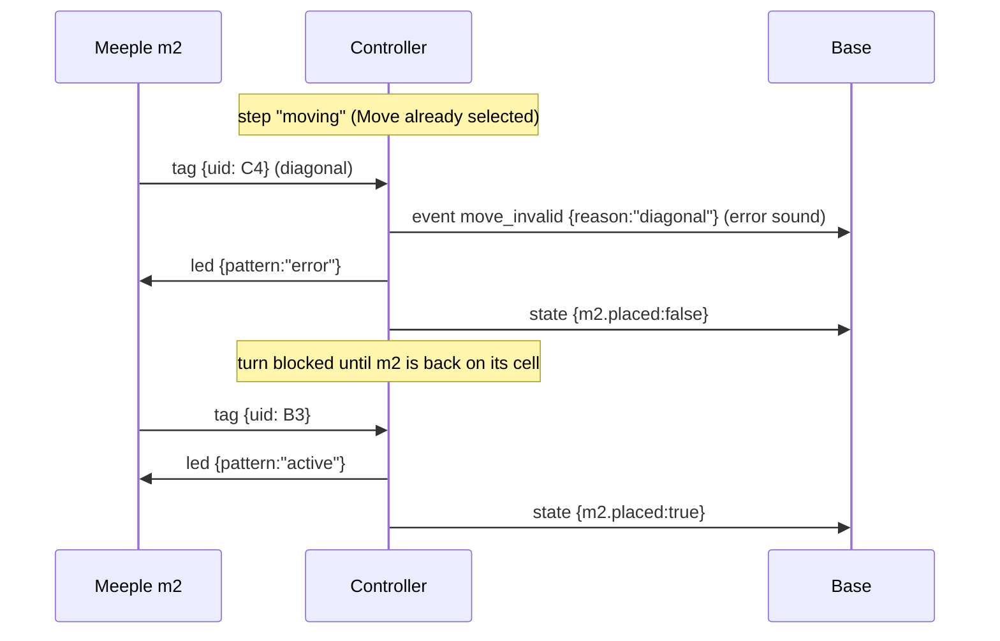

# Last Meeple Standing – Communication Protocol

> Status: **draft v0.1** (milestone M1). Everything here must be agreed by the
> whole group before firmware and controller code depend on it.

## 1. Architecture

```
 ┌──────────────┐  tag reads        ┌──────────────────┐   state / events   ┌───────────────┐
 │ Meeple ×4    │ ───────────────▶  │                  │ ─────────────────▶ │ Control base  │
 │ ESP-01+PN532 │ ◀───────────────  │  Rules controller│ ◀───────────────── │ ESP32 + LCD   │
 └──────────────┘  LED commands     │  (PC, authority) │   menu actions     │ button/buzzer │
                                    └────────┬─────────┘                    └───────────────┘
                                             │ state / events
                                             ▼
                                       ┌───────────┐
                                       │ Frontend  │  (read-only viewer)
                                       └───────────┘
                 all links go through the Mosquitto broker on the PC (ad hoc LAN)
```

Design principles:

1. **The rules controller is the single source of truth.** Meeples and the base
   never change game state, they only report *inputs* (a tag was read, the
   player chose an action in the menu) and render *outputs* (LEDs, LCD, buzzer).
2. **The controller decides what is allowed, the base only shows it.** The
   controller publishes in `game/state` which options the active player has.
   The base turns them into an on-screen menu, handles the navigation locally
   and sends only the chosen action. The controller validates every action
   again before applying it. The meeple sends a tag UID, not a cell, and the
   controller decides what it means.
3. **Event-driven, asynchronous by default.** Nobody polls. Every component
   reacts to messages.
4. **Small payloads for small devices.** The ESP-01 has ~40 KB of free heap,
   so meeples only subscribe to their own LED topic, never to the full state.

Hardware per component (from the LAB kit 26/27):

| Component | Hardware | Notes that affect the protocol |
|---|---|---|
| Meeple ×4 | ESP-01, PN532 RFID reader (I2C), 1 red LED, powerbank | A single-colour LED can only show blink patterns. |
| Control base ×1 | ESP32 (FreeRTOS), 128×64 graphic serial LCD (5 V), passive buzzer, push button, LED | Renders everything from `game/state`. Sounds come from `game/event` with `tone()`. |
| Board | 4×4 grid, one RFID tag per cell | Tag UIDs are mapped to cells in a config file. |
| Network | ad hoc LAN created by the group, broker on the PC | Fixed broker IP. |

## 2. MQTT topic tree

Root prefix: `lms/` (Last Meeple Standing). `{id}` is the meeple id `m1`…`m4`. The `id` is assigned the first time the ESP01 Chip ID is read and is not changed.

| Topic | Publisher → Subscriber | Retained | Purpose |
|---|---|---|---|
| `lms/meeple/{id}/tag` | meeple → controller | no | RFID tag placed / removed |
| `lms/meeple/{id}/led` | controller → meeple | **yes** | LED pattern to show |
| `lms/meeple/{id}/status` | meeple → controller | **yes** | online / offline (LWT) |
| `lms/meeple/{id}/log` | meeple → frontend | no | debug text (no serial port free on the ESP-01) |
| `lms/base/action` | base → controller | no | action chosen in the menu |
| `lms/base/status` | base → controller |  **yes** | online / offline (LWT) |
| `lms/game/state` | controller → base, frontend | **yes** | full game snapshot |
| `lms/game/event` | controller → base, frontend | no | things that just happened (sounds, messages) |
| `lms/game/cmd` | frontend / CLI → controller | no | admin: start, reset, pause |
| `lms/controller/status` | controller → all | **yes** | online / offline (LWT) |

Why retained where it is: a device that (re)connects immediately receives the
current state, its current LED pattern and who is online, without having to
ask for it. Events are **not** retained: replaying an old "hit" sound on
reconnect would be wrong.

### 2.1 QoS 2 and MQTT client library

All game topics use **QoS 2** (exactly once). In a turn-based game every
input matters: a lost tag read leaves the board out of sync, and a duplicated
action would pass the turn of the next player. QoS 2 makes the broker
guarantee that each message is delivered exactly once on every hop. Only `log`
uses QoS 0: losing a debug line does not matter and it saves traffic on the
ESP-01.

**Library choice.** The usual Arduino MQTT library, PubSubClient, can only
*publish* with QoS 0 (it can subscribe with QoS 1 at most), so it cannot
provide QoS 2. Because we want QoS 2 we use:

| Component | Library | QoS 2 publish and subscribe |
|---|---|---|
| Meeple (ESP-01 / ESP8266) | AsyncMqttClient | yes |
| Control base (ESP32) | AsyncMqttClient | yes |
| Controller (PC) | paho-mqtt | yes |

Using the same library on both firmwares also lets the meeple and the base
share their MQTT connection code.

Rules to get real QoS 2 end to end:
- **Subscribe with QoS 2 too.** The broker delivers each message with the
  lower of the publish QoS and the subscribe QoS.
- **Persistent sessions.** Every client connects with `cleanSession = false`
  and a fixed client id (meeples: `lms-m1`…`lms-m4`, `lms-base`,
  `lms-controller`), so the broker keeps queued QoS 2 messages while a device
  is briefly offline.

Subscriptions per component:

| Component | Subscribes to |
|---|---|
| Meeple `m2` | `lms/meeple/m2/led`, `lms/controller/status` |
| Control base | `lms/game/state`, `lms/game/event`, `lms/controller/status` |
| Controller | `lms/meeple/+/tag`, `lms/meeple/+/status`, `lms/base/action`, `lms/base/status`, `lms/game/cmd` |
| Frontend | `lms/#` (read-only, debugging and visualization, includes meeple logs) |

## 3. Message anatomy

All payloads are UTF-8 JSON objects. Common fields:

| Field | Type | Meaning |
|---|---|---|
| `seq` | int | per-device counter, +1 on every message sent (inputs only). Used to drop duplicates. |
| `rev` | int | game state revision, +1 on every state change (controller messages only). |
| `ts` | int | sender time in ms (`millis()` on the ESPs, epoch ms on the PC). Debug only, never used for logic. |

### 3.1 Inputs (devices → controller)

**`lms/meeple/{id}/tag`** – tag placed (sent once the same UID has been read
stably for 300 ms) or removed:
```json
{ "seq": 17, "uid": "04A1B2C3", "ts": 51234 }
{ "seq": 18, "uid": null,       "ts": 53010 }
```
The controller translates `uid` to a cell with the board map
(`game-controller/config/board.json`, milestone M4):
```json
{ "04A1B2C3": "A1", "04D4E5F6": "A2", "...": "..." }
```

**`lms/base/action`** – sent once, when an option is selected in the menu
(§4.3):
```json
{ "seq": 5, "action": "attack", "target": "m1", "seen_rev": 42, "ts": 120400 }
{ "seq": 6, "action": "pass", "seen_rev": 44, "ts": 131020 }
```
| `action` | Extra fields | Meaning |
|---|---|---|
| `move` | — | arm the movement: the controller starts accepting a tag read from the active meeple |
| `cancel_move` | — | "Back" while moving, before placing the meeple |
| `attack` | `target` | attack that adjacent rival |
| `pass` | — | end the turn |
| `start` | — | lobby: start the game |
| `new_game` | — | game over: back to the lobby |

`seen_rev` is the state revision the menu was built from (see §5). Navigation
between options never leaves the base.

**`lms/meeple/{id}/status`**, **`lms/base/status`** (also used as LWT):
```json
{ "online": true, "fw": "0.1.0", "ip": "192.168.4.11", "rssi": -58 }
{ "online": false }
```

### 3.2 Outputs (controller → devices)

**`lms/meeple/{id}/led`**:
```json
{ "rev": 42, "pattern": "active" }
```
The meeple has a single red LED, so every pattern is an on/off timing:

| Pattern | Meaning | LED |
|---|---|---|
| `off` | lobby, not on its start cell yet | off |
| `idle` | alive, waiting for its turn | steady on |
| `active` | it is this meeple's turn | slow blink (500 ms on / 500 ms off) |
| `error` | invalid move, return to your cell | fast blink (100 / 100 ms) |
| `danger` | on a lightning-warning or burning cell | double flash every second |
| `dead` | eliminated | off |
| `winner` | game over, this meeple won | fast blink for 5 s, then steady |

The meeple also has local LED states that need no message: fast blink while it
is connecting to Wi-Fi/MQTT, and steady on for 1 s when a tag is read.

**Base LED** (local, no topic): steady = connected to the controller;
blinking = game paused or controller offline; off = no Wi-Fi.

**`lms/game/state`** – full snapshot, retained:
```json
{
  "rev": 42,
  "phase": "playing",
  "round": 4,
  "order": ["m3", "m1", "m2", "m4"],
  "turn": { "player": "m2", "step": "moved", "options": ["attack", "pass"], "targets": ["m1"] },
  "players": {
    "m1": { "cell": "B2", "hp": 7,  "weapon": "knife", "alive": true,  "online": true, "placed": true },
    "m2": { "cell": "B3", "hp": 10, "weapon": "fists", "alive": true,  "online": true, "placed": true },
    "m3": { "cell": "D1", "hp": 0,  "weapon": "axe",   "alive": false, "online": true, "placed": true },
    "m4": { "cell": "D4", "hp": 4,  "weapon": "sword", "alive": true,  "online": true, "placed": false }
  },
  "items":     { "A2": "small_heal", "C3": "spear" },
  "fire":      { "C1": 2 },
  "lightning": ["A3"],
  "respawn":   { "B1": 2 },
  "winner": null
}
```
- `phase`: `lobby` → `playing` ⇄ `paused` → `finished`.
- `turn.step`: `start` (no action yet) → `moving` ("Move" selected, waiting
  for the meeple to be placed) → `moved` (can attack or pass) → next player.
- `turn.options`: actions the active player can choose now; the base builds
  the menu from this list. `attack` only appears if `targets` (adjacent living
  rivals) is not empty. `move` only appears in `start`.
- `placed: false`: the physical meeple is not on the cell the controller
  expects (lifted, or left on an invalid cell).
- `fire`: rounds of fire left per cell. `lightning`: cells that will be struck
  at the end of this round. `respawn`: rounds left before an item reappears.

**`lms/game/event`** – transient, drives sounds and LCD messages:
```json
{ "rev": 43, "type": "attack_hit", "by": "m2", "on": "m1", "weapon": "knife", "dmg": 2, "hp": 5 }
```
| `type` | Extra fields | Base reaction |
|---|---|---|
| `game_start` | `order` | start jingle |
| `turn_start` | `player`, `round` | short beep |
| `move_ok` | `player`, `from`, `to` | — |
| `move_invalid` | `player`, `reason` (`diagonal`, `not_adjacent`, `occupied`, `second_move`, `not_your_turn`, `move_not_selected`, `unknown_tag`) | error sound |
| `action_rejected` | `action`, `reason` (`stale`, `not_allowed`, `invalid_target`) | error sound, menu rebuilt from the current state |
| `pickup` | `player`, `item`, `cell` | pickup sound |
| `attack_hit` | `by`, `on`, `weapon`, `dmg`, `hp` | hit sound |
| `attack_miss` | `by`, `on`, `weapon`, `roll` | miss sound |
| `pass` | `player` | — |
| `lightning_warning` | `cells` | warning sound + LED |
| `lightning_strike` | `cells`, `hits` | strike sound |
| `fire_damage` | `player`, `hp` | — |
| `eliminated` | `player`, `cause` | elimination sound |
| `paused` / `resumed` | `reason` (`device_offline`, `admin`) | — |
| `game_over` | `winner`, `reason` (`last_alive`, `round_limit`) | victory jingle |

**`lms/game/cmd`**:
```json
{ "cmd": "start" }   { "cmd": "reset" }   { "cmd": "pause" }   { "cmd": "resume" }
```

## 4. Direction and triggering

### 4.1 Communication startup



Order of startup does not matter: every component can boot in any order
because retained messages give late joiners the current picture.

### 4.2 Synchronous vs asynchronous interactions

MQTT is asynchronous publish/subscribe so there is no request/response built in.

- **Asynchronous (fire-and-forget):** menu actions, tag reads, status
  changes, events, state broadcasts. The sender never waits.
- **Request → reaction (logically synchronous):** a move or an attack is a
  *request* that only becomes real when the controller answers. The meeple
  publishes a tag read and the result arrives as a new `game/state` +
  `game/event` (+ LED change). The input's `seq` is echoed in the event
  (`"req": {"from": "m2", "seq": 17}`) so the sender can match the answer.
  The devices do **not** block waiting; they keep showing the last state.
- **Turn flow is strictly sequential** inside the controller: inputs are
  processed one at a time from a single queue, so two inputs can never be
  applied concurrently.

### 4.3 Menu on the control base (single button)

The base shows a menu on the LCD and the single button always works the same
way:

- **Short press** (< 600 ms): move the cursor to the next option. The menu is
  circular: after the last option it goes back to the first one.
- **Long press** (≥ 600 ms): select the option under the cursor. The buzzer
  beeps when 600 ms are reached, so the player knows they can release.
- Every submenu ends with **Back**, which returns to the previous menu.

The menu lives in the base: moving the cursor sends nothing over MQTT, so the
cursor reacts instantly. Only the final selection is sent to
`lms/base/action`. The options come from `turn.options` and `turn.targets` in
`game/state`, so the base never shows an option the rules do not allow.

Menus:

```
LOBBY                 TURN M2 (R4)          MOVE                  ATTACK
> Start game          > Move                Place your meeple     > M1  B2  7hp
                        Attack              on a free cell        M4  C3  4hp
                        Pass                > Back                Back

AFTER MOVING          GAME OVER
> Attack              M2 wins!
  Pass                > New game
```

| Menu | Option selected | Sent | Result |
|---|---|---|---|
| Lobby | Start game | `start` | game starts (≥ 2 meeples on corners) |
| Turn | Move | `move` | step `moving`; the controller accepts one tag read from the active meeple |
| Move | Back | `cancel_move` | back to step `start` (only before placing the meeple) |
| Turn / After moving | Attack | — | opens the Attack submenu (local) |
| Attack | a rival | `attack` + `target` | attack resolved, turn ends |
| Attack | Back | — | back to the previous menu (local) |
| Turn / After moving | Pass | `pass` | turn ends |
| Game over | New game | `new_game` | back to the lobby |

**Move must be selected first.** A tag read from the active meeple is only
accepted as a move in step `moving`. If the meeple is moved without selecting
Move (for example, someone knocks it by accident), the controller answers
`move_invalid {reason:"move_not_selected"}` and the meeple must go back to its
cell, as with any invalid move.

Menu rules on the base:
- When a new `game/state` arrives (higher `rev`), the menu is rebuilt from it
  and the cursor goes back to the first option. For example, if a rival dies
  while the Attack submenu is open, it disappears from the list.
- After sending an action, the menu is locked (shows "...") until a state with
  a higher `rev` or an `action_rejected` event arrives. This prevents sending
  the same action twice. If nothing arrives in 3 s, the menu is unlocked again.
- While the game is `paused`, the menu is hidden and the LCD shows the reason.

### 4.4 A full turn: move + attack



### 4.5 Invalid move



## 5. State synchronization

1. **One writer.** Only the controller publishes `game/state`. Every state
   change increments `rev` and publishes the whole snapshot (≈ 600 bytes),
   so there are no partial updates that could be lost or applied out of order.
2. **Retained snapshot.** A device that reboots or reconnects gets the
   latest state from the broker instantly. No "resync" request is needed.
3. **Revisions.** Clients ignore any state or event with `rev` lower than the
   last one they applied (protection against reordering).
4. **Stale actions.** The base sends `seen_rev`, the revision its menu was
   built from. If the turn changed since then (`turn.player` differs) or the
   action is no longer in `turn.options`, the controller rejects it with
   `action_rejected`. This avoids an action meant for one player being applied
   to the *next* player.
5. **Duplicates.** All game topics use QoS 2 (exactly once), so MQTT itself
   does not deliver a message twice. QoS 2 only covers each hop inside one
   MQTT session, though: if a device reboots or its firmware re-sends a message
   after reconnecting, the broker sees a new message. The controller therefore
   still remembers the last `seq` per device and drops any message with
   `seq <= last`. A device that reboots restarts from `seq = 0`; its
   `status {online:true}` message resets the counter.
6. **Physical vs logical state.** The physical position of a meeple can differ
   from the logical one (invalid move, lifted piece). The controller keeps the
   logical cell and a `placed` flag; the game does not advance while the active
   player is not `placed`, and the LCD shows who must fix their meeple.
7. **Persistence.** The controller saves the state to
   `game-controller/data/state.json` after each change and reloads it on start,
   so a controller crash does not lose the game.

## 6. Robustness

| Risk | Detection | Solution |
|---|---|---|
| Device loses Wi-Fi / reboots | LWT publishes `{online:false}`; keepalive 10 s | Game goes to `paused` if the active meeple or the base is offline; resumes automatically when it is back. Retained state restores the device. |
| Controller crashes | `lms/controller/status` LWT | Devices show "waiting for controller"; controller reloads `state.json` and republishes. |
| Duplicated messages | QoS 2 handshake; `seq` per device | QoS 2 removes protocol duplicates; `seq <= last_seq` drops re-sends after a reboot or reconnect. |
| Lost messages | — | QoS 2 + persistent sessions (§2.1), so the broker queues messages while a device is briefly offline; full snapshots fix anything still missed. |
| RFID bouncing / partial reads while sliding the meeple | — | Meeple debounce: same UID read stable for 300 ms before publishing. |
| Unknown tag (not in board map) | lookup fails | `move_invalid {reason:"unknown_tag"}`, ignored. |
| Meeple moved out of turn | `turn.player != id` | `move_invalid {reason:"not_your_turn"}`, `placed:false`, error LED. |
| Meeple knocked or moved by accident during its own turn | tag read outside step `moving` | Not counted as a move: `move_invalid {reason:"move_not_selected"}`, the meeple goes back to its cell. |
| Double or stale action | `seen_rev`, `seq`, menu lock | Menu locked until the answer arrives; the controller rejects actions from an old turn or not in `turn.options`. |
| Base menu shows options that are no longer valid | new `rev` | Menu rebuilt on every new state; the controller validates every action again. |
| Malformed JSON / missing fields | schema validation in the controller | Message discarded and logged; never crashes the controller. |
| ESP-01 memory limits | — | Meeple only subscribes to its own LED topic; payloads < 100 bytes. |
| `game/state` (~600 B) arrives in several TCP chunks | partial payload in the callback | AsyncMqttClient delivers big messages in fragments (`index`, `total`): the base joins them in a buffer before parsing the JSON. |
| QoS 2 in-flight messages use RAM on the ESP-01 | — | Meeple payloads are < 100 B and it only has one subscription, so few messages are pending at a time. |
| ESP-01 / ESP32 need time to start (kit warning) and boot in any order | — | Retry Wi-Fi and MQTT with backoff; retained messages make boot order irrelevant (§4.1). |
| No serial debug on the meeple (TX/RX pin used for the LED) | — | Debug text on `lms/meeple/{id}/log`. |
| Powerbank turns off under low current draw | meeple LWT fires | Test the kit powerbanks with the meeple running; the game pauses (row 1) if it happens. |
| Network / broker setup at the demo | — | Broker on the PC, fixed IP on the ad hoc LAN, configured in one header file per firmware. |
| Bugs in random rules hard to reproduce | — | Controller RNG is seeded and the seed is logged; simulated clients replay full games (M5). |

## 7. Rule updates derived from the protocol

These are not in the original rules document and need group approval:

- The base shows a menu: short press = next option, long press = select,
  every submenu has Back (§4.3).
- To move, the player must first select Move in the menu and then place the
  meeple. A move without selecting Move is invalid.
- Lobby: the game starts by selecting "Start game" once at least 2 meeples are
  placed on corner cells. Players that are not online at start do not play.
- A player whose meeple is not on its logical cell blocks their own turn until
  it is put back.
- The game pauses if the active meeple or the base goes offline.
